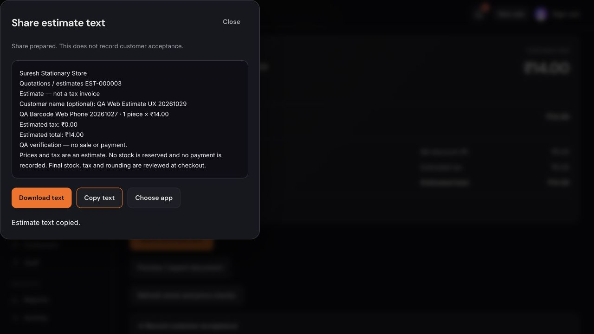

# Web estimate workspace — 29 October 2026

The web estimates destination now uses the current shared workflow and composition-tax diagnostics, with web-specific presentation. Sell and Sales have matching header entry points. The list provides search and status filters; drafts use an Items → Customer & terms editor with inline quantity/price/contact guidance, retained values when stepping back, and discard confirmation. Saved previews distinguish issuing blockers from product tax review required before billing. Acceptance, revisions and history use separate disclosures. Share preparation opens a panel with localized text, copy, download and a browser share-sheet option when available.

All new labels are bundled in English, Hindi, Hinglish, Tamil, Telugu, Bengali, Marathi, Kannada, Gujarati and Malayalam. Existing non-estimates WIP in the source checkouts is preserved.

## Verified locally

- Real estimate API/store running against the existing isolated localhost fixture; no production credentials or authentication bypass.
- Created QA Web Estimate 20261029, saved fractional quantity 1.125 × ₹25, issued EST-000003 for ₹28.13, and reopened the same issued estimate after reload.
- Zero quantity blocks continuation with inline guidance. Invalid customer phone preserves input and shows its translated error. Header Back retains quantity and customer details. Cancel asks before discarding; Keep editing retains the draft.
- Downloaded EST-000003.txt and verified its number, customer, fractional quantity, total and estimate disclaimer. Copy action reported success. External recipient delivery was not attempted.
- All ten languages rendered without raw estimate keys; Hindi layout inspected visually.
- Simulated a lost share response. The original retained request was retried successfully; the estimate stayed issued, version 4, with one event for that share request. No bill, stock mutation or payment was created by these checks.
- The full release check passed before removing temporary QA routes. After removal, Next's stale development route declarations required regeneration; route declarations were regenerated. TypeScript and the optimized production build then passed with 147 generated pages.

Temporary development routes and reverse proxy are excluded from the release; harness sources are retained only in /tmp/samaan-web-estimates-ux-qa for reproduction.

## Live verification

The main UI release was merged in PR #146 and published by Netlify deploy `6ae245f5ea8878922bca152c`, commit `46e43f28f9a314d0c9af2a7c1ff7947c9f2fd3a9`, at 2026-10-28 19:00:26 UTC (29 October IST).

- Created `QA Web Estimate UX 20261029`, ID `c0ee82ec-f890-41bd-9d71-ec28a8da0bf6`, and issued **EST-000003 for ₹14.00** in the composition shop. The product now has a saved tax profile; no product or shop tax details were changed during this QA.
- The persisted record has exactly `create`, `issue`, `share` events, status `issued`, and no sale ID. Product stock remained **2** before and after these actions.
- Downloaded text matched its issued number, item, quantity, price, total and non-invoice disclaimer. Copy reported success. No message was sent to an external recipient.
- Document preview retained the issued presentation. PDF export downloaded successfully (74,077 bytes, valid PDF header).
- Search found the QA estimate; reopening and reloading retained its issued state.
- Sell → Estimates → Back returned to Sell. Sales → Estimates → Back returned to Sales. The existing counter cart was not edited.
- A final presentation cleanup clears a completed detail-page confirmation when returning to the list; financial workflow and request replay are unchanged.

